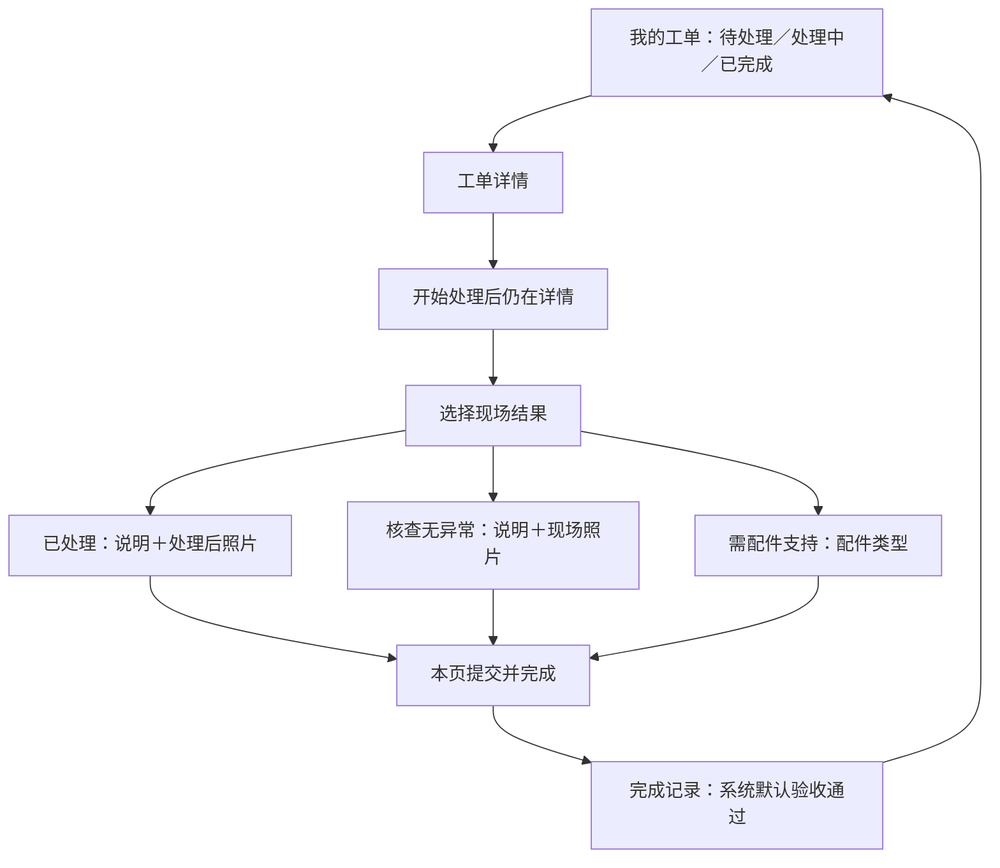

# 智慧车站 · 巡检工单一期首轮设计

日期：2026-11-11（亚洲/上海）\
设计版本：D0.1，首轮视觉与主流程已由用户验收通过（2026-11-11）\
需求依据：[V1.4 当前需求](../../车站巡检工单一期-两端模拟演示需求-2026-11-11.md)及本轮用户确认的名称“智慧车站”、指令“开始设计”。

最新确认：用户已回复“好的，验收通过”，并要求新建 Android App 与智慧车站大屏两个开发会话。当前已获业务开发授权。通过范围为本轮实际交付的视觉与主流程原型；隐藏调试、延时来单及通知仍由 App 开发会话按 V1.4 和本轮视觉补齐，不继承未执行的功能或实机验收结论。

## 1. 本轮交付与边界

本目录为独立 UI 设计及浏览器交互原型，不接入现有 Vue 页面、后台、推理接口或 Android 工程。没有读取归档旧设计作为需求依据，不继承历史完成结论。

- 入口为 `index.html`，相邻资源全部本地提供，可通过浏览器打开，也可通过本机静态服务访问。
- 手机端覆盖列表、详情、开始处理、三类结果、填写材料、照片预览、提交和完成记录。
- 大屏端只复现检查卡片与原证据弹窗局部，展示新增下发动作及状态；未重绘或改造三维、任务控制及管理台。
- “12 项场景”位于评审工具中，仅用于素材与检查点核对，不是正式 App 场景选择入口，也不向业务列表加入全部工单。
- 设备宽度、字体比例、恢复首屏、设计说明和页面注释均位于 App 画面外，不进入产品页面。
- “恢复首屏”只清理本浏览器原型自己的进度和照片副本，经确认后恢复默认三单。它不是正式 App 隐藏调试页的“清除本地数据”设计。

隐藏四连点、工单调试、单项／多项配置、重置确认、等待来单、权限引导与系统通知尚未在本轮原型中实现。视觉、信息层级和主操作位置现已获得用户确认，后续由 App 开发会话补齐这些页面与交互。没有把未完成内容标为通过。

## 2. 视觉与布局

| 项目 | 首轮方案 |
| --- | --- |
| App 名称 | 智慧车站 |
| 页面底色 | `#0B192B`，深蓝 |
| 卡片底色 | `#15283E`，与页面形成适度层次 |
| 主操作 | `#52E0C4`，深色按钮文字 |
| 正文／辅助文字 | `#EDF5FB`／`#9EB2C7` |
| 状态 | 待处理为暖色，处理中为蓝色，已完成为青绿色；同时保留文字 |
| 页面左右留白 | 12dp 对应的浏览器逻辑像素基线 |
| 字号 | 正文 16、辅助 14、页面标题 20；卡片问题标题 18 |
| 主按钮／触控 | 主按钮至少 52；一般触控目标至少 48 |
| 卡片圆角 | 14；主按钮圆角 10 |
| 主适配 | MC62 宽 320、高约 533 的全屏逻辑尺寸；浏览器中留出 24 的系统状态栏表达 |
| 普通手机 | 390 宽度预览，单独保留手势导航区域的视觉表达 |
| 字体检查 | 100%、125%、150%，使用换行和滚动，不通过压小字号容纳内容 |

浏览器逻辑像素用于设计对照，并不等于已在 Android 中验证 dp、sp 或实际系统窗口。正式实现须读取实际系统栏、键盘及窗口尺寸，不能照搬原型中的固定预览高度。

页面不增加登录、人员选择、底部业务导航或额外统计板。列表优先展示问题、完整位置，然后展示接收时间与工单编号。卡片整块可点，状态分类含当前数量。默认三单始终为垃圾桶、消火栓、闸机。

详情依次展示问题与位置、说明、原始证据、工单信息、已有处理记录。首屏不强行塞满照片和全部字段，正文允许滚动，底部保留主操作。点击“开始处理”后仍在详情；无草稿显示“填写结果”，有草稿显示“继续填写”。

照片在证据区采用完整显示，避免裁切掉现场信息；放大页支持缩放和切换。配件类不展示照片必填项，不把工单完成写成设备已修复。

## 3. 页面流转及首轮状态

| 页面 | 本轮可评审状态 |
| --- | --- |
| 我的工单 | 默认三项、三分类计数、分类空态、有草稿提示、返回保留列表位置 |
| 工单详情 | 待处理、开始后留页、处理中、原始证据、实际发生的开始记录 |
| 结果选择 | 三项纵排、首次不预选、选择及更换结果 |
| 材料填写 | 三种分支、字段必填、照片必填、待上传／正在上传／上传成功、提交中、保存失败反馈 |
| 照片 | 浏览器拍照入口、选择图片、完整预览、放大、切换、移除和撤销 |
| 完成记录 | 三类结果分别完成、实际提交的材料及时间、默认验收、原始证据保留、只读返回 |
| 大屏局部 | 下发、成功反馈、李明和时间、关闭重开保持已下发、卡片末行标记、防止重复下发 |

结果分支各自保留材料，提交只使用当前分支。浏览器原型将进度与可读取的照片副本保存在自己的本地存储中；图片为节省浏览器存储做尺寸压缩，此处理不作为 Android 照片保存规格。浏览器存储失败时明确提示，不假报提交完成。

输入框聚焦时，提交区移入表单滚动区域，失焦后恢复底部操作。此处检查的是浏览器表单的可达性，中文输入法实际窗口、焦点与返回行为仍需 Android 实机验收。

## 4. 12 项检查点与图片映射

核对依据仅为当前源码：`multiDeviceConfig.js`、`fixedRoutes.json`、`routeNodeEffects.js`，用于确定当前检查点及素材关系，不从代码历史反推本期业务规则。

| 来源与检查项 | 路线点序号 | App 问题标题 | 当前绑定图片 | 默认 |
| --- | --- | --- | --- | --- |
| A01 / gate | 2 | 闸机运行异常 | gate-running-status.jpg | 是 |
| A01 / tvm | 5 | TVM购票机状态异常 | tvm-status.jpg | 否 |
| A01 / light | 6 | 照明灯亮度异常 | lighting-brightness.png | 否 |
| A01 / escalator | 8 | 电扶梯运行异常（A01 检查点） | escalator-a02.jpg | 否 |
| A01 / rolling-door | 17 | 卷帘门开关异常 | rolling-door-status.png | 否 |
| A02 / trash | 2 | 垃圾桶满溢或摆放异常 | trash-overflow.jpg | 是 |
| A02 / hydrant-door | 3 | 消火栓门状态异常 | hydrant-door.jpg | 是 |
| A02 / fight | 5 | 发现人员打架 | passenger-fight.jpg | 否 |
| A02 / emergency-light | 6 | 应急指示灯状态异常 | emergency-exit-sign.jpg | 否 |
| A02 / comatose | 8 | 发现人员躺卧或疑似昏迷 | passenger-lying.jpg | 否 |
| A02 / flood-supply | 9 | 防汛物资状态异常 | flood-supplies.jpg | 否 |
| A02 / escalator | 10 | 电扶梯状态异常（A02 检查点） | escalator-a01.jpg | 否 |

图片来自现有 `src/assets/images/fullspace/inspection/`，复制到本目录供独立打开；未改写源图，没有生成新现场证据。原图中的拍摄标记原样保留。

需要在内容确认时核对的两点：

1. 当前 A01 使用文件名带 `a02` 的电扶梯图片，A02 使用带 `a01` 的图片。首轮严格按现有实际绑定呈现，未擅自交换；文件名不能单独证明现场对应关系正确或错误。
2. 当前记录能确认车站、来源设备、检查名称及路线点，缺少楼层、出入口等完整位置描述。首轮采用“云谷路地铁站 · 来源设备＋检查点”，并未虚构更具体的地点。检查说明根据 V1.4 的预置问题写成核查提示，不表示重新识别照片得到了真实故障结论。后续若要求精确到楼层或编号，需要补充已确认的位置。

## 5. 大屏局部设计依据

- 原结构参考当前 `MultiCheckEvidence.vue`；单栏 640px、最大宽度限制、内部滚动、关闭按钮及点击遮罩关闭均保留。
- 原卡片参考当前 `RightPanelScene3D.vue`，仅在末行追加“工单已下发”。
- 下发区位于原证据内容末尾，不插入人员选择或新的派单表单。
- 下发后显示“已下发”、李明及本次浏览器操作时间；原异常结论仍显示异常。
- 本轮大屏展示的是独立预设异常数据及固定评审时间，不是真实后台报告；未向现有巡检执行写入任何数据。
- 尚未在实际大屏工程中验证原任务操作、三维、统计及全部检查状态，不能以局部原型操作通过替代 W03 验收。

## 6. 下一轮设计与确认点

本轮已获用户确认：深蓝卡片与青绿操作的视觉、问题位置优先的信息顺序、320 窄屏的密度、底部主操作和大屏局部衔接。后续 App 开发会话继续：

1. 补齐“工单调试”独立滚动页、标题四连点、状态信息、作用工单、单单重置、清材料、清本地数据及操作速度。
2. 补齐默认三项／单项／多项、A01／A02 分组、全选／清空与无效数量校验；作用工单与新场景配置相互独立。
3. 补齐等待时间、重新开始确认、通知许可与定时条件提示、返回桌面预览、等待空态及到达通知点击。
4. 明确区分待确认配置和已安排计划，保留每批一条通知、实际工单数及失败不清数据等规则。
5. 逐项对照 V1.4 的 D、N 验收要求完成原型检查，再交付完整状态截图与 Android 实机待验清单。

原型中的系统通知及返回桌面后续只作交互呈现，不声称已验证后台、锁屏、划掉任务后的 Android 提醒。功能操作、UI 还原、两类实机交互分别记录。

## 7. 首轮浏览器检查

检查结果与截图保存在 `review/`。检查结果只覆盖本轮交付页面，最终记录以 `review/检查结果.json` 为准；隐藏调试和延时通知不在本轮通过范围。

本轮最终浏览器检查通过 55 项断言，无脚本错误。覆盖默认三项、分类空态、开始后留在详情、三类独立提交、必填校验、回车不提交、分支材料保留、照片读取／状态／预览／移除／撤销、重开恢复材料、大屏防重复下发、12 项素材读取，以及 320／390 宽度的列表、详情、填写页在 100%／125%／150% 字体下的横向溢出检查。结果选择页在 320 宽度及 100% 字体下已检查；其余组合仍需在完整原型阶段补齐。关键截图已人工查看，本轮 UI 已由用户确认。

主预览截图：[首轮页面预览](review/首轮页面预览.png)。界面操作检查通过不等于用户已确认视觉，也不等于 Android 实机或业务工程已通过验收。

本目录图标使用项目运行环境附带的 Lucide 本地库；图标库许可证头保留在资源文件中。评审页列车符号仅用于评审页面识别，不代表已确定 Android 启动图标。
